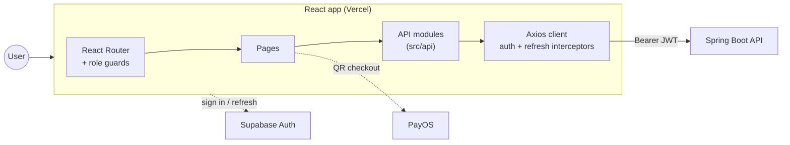

<h1 align="center">fonlio · Web App</h1>

<p align="center">
  The React web client of <a href="https://www.fonlio.online"><b>fonlio</b></a>, a gamified reputation and hyperlocal talent marketplace for Gen Z in Vietnam.
</p>

<p align="center">
  <a href="https://github.com/proj-nextplease/frontend/actions/workflows/ci.yml"></a>
  
  
  
  
</p>

<p align="center">
  <a href="https://www.fonlio.online"><b>🌐 Live site</b></a> ·
  <a href="https://github.com/proj-nextplease/backend">Backend API</a> ·
  <a href="https://github.com/proj-nextplease/frontMobile">Mobile app</a>
</p>

---

## Overview

fonlio helps students build a **verified reputation** through jobs, quests and credentials, and helps businesses find and hire local talent. The platform is **live with 100+ users**.

This repository holds the web app for all three audiences:

| Audience | What they can do |
|---|---|
| **Candidates** | Browse and apply for jobs and quests, track applications, build and publish a portfolio, submit credentials for verification, top up the NP wallet, upgrade to Premium, join discussions |
| **Businesses** | Register and get verified, post jobs and quests, manage the applicant pipeline, invite team members |
| **Admins** | Review business verification and credentials, manage system configuration and the ambassador program |

The app is a **thin client by design**: it never calculates or changes Reputation Score, EXP, wallet balance, Premium status, verification results or payment state. Every one of those values is rendered from the [backend API](https://github.com/proj-nextplease/backend), which is the single source of truth.

<!-- Tip: add 2–3 screenshots here, e.g.  -->

---

## Highlights

### 🔐 Resilient authentication
- Sign-in with **Supabase Auth** (email and Google). Every API request carries the access token, attached by an **Axios request interceptor**.
- A **response interceptor** handles expired sessions: on a `401` it refreshes the Supabase session silently and retries the original request **once**. If the refresh fails, it clears the stale session and redirects the user to the correct login page for their role.
- **Role-based route guards** for candidates, businesses and admins.
- **Return-to-page after login**: the page the user was on is kept in `sessionStorage`, so it survives the OAuth redirect and stays separate per browser tab.

### 💳 Payments
- **PayOS checkout** that renders the VietQR code in the browser and **polls the payment status** until the backend confirms the webhook. The wallet is credited by the server only, never by the UI.
- Wallet card, transaction history and Premium upgrade flow.

### 🎨 Immersive UI
- **Three.js** 3D scenes for the landing pages, the waitlist and a "Wrapped"-style **candidate universe** that turns a user's achievements into an interactive 3D story.
- **Portfolio builder** with 3 themed templates, a **live preview**, a draft and publish flow, and public share links (`/p/:slug`).
- Gamification feedback: reward celebrations, EXP and Reputation display, a Premium VIP card and notification bell.

### ⚡ Performance
- **Route-level code splitting**: the heavy 3D and portfolio pages are lazy-loaded, so the initial bundle stays small.
- **Prefetch cache with in-flight deduplication**: the job list starts loading from the home page and opens instantly on the Jobs page, and concurrent requests share one network call.
- **Client-side image compression** before upload: phone photos of 3–8 MB are resized and re-encoded to roughly 150–400 KB.

### ✅ Data quality & compliance
- Shared **Vietnamese validation rules** (tax codes per Circular 105/2020, phone numbers, provinces), reused across every business form so the rules never drift.
- A **legal consent gate**: Terms and Privacy must each be scrolled to the end before the user can create an account.

---

## Tech stack

| Area | Technology |
|---|---|
| Framework | React 19, Vite 7 |
| Routing | React Router 7 |
| Auth | Supabase JS (`@supabase/supabase-js`) |
| HTTP | Axios with request and response interceptors |
| UI | Astryx design system, StyleX, custom CSS themes, Lucide icons |
| 3D | Three.js |
| Payments | PayOS (VietQR rendered with `qrcode`) |
| Quality | ESLint 9 (React Hooks rules) |
| CI / CD | GitHub Actions (lint and build on every push and PR to `main`), Vercel |

---

## Architecture



---

## Getting started

### Prerequisites
- Node.js 20+
- The [backend API](https://github.com/proj-nextplease/backend) running locally (default `http://localhost:8080`)

### Run locally
```bash
git clone https://github.com/proj-nextplease/frontend.git
cd frontend
npm install
cp .env.example .env.local   # then fill in the values below
npm run dev
```

The app starts on `http://localhost:5173`.

### Environment variables

| Variable | Description |
|---|---|
| `VITE_API_BASE_URL` | Backend API base URL, e.g. `http://localhost:8080/api/v1` |
| `VITE_SUPABASE_URL` | Supabase project URL |
| `VITE_SUPABASE_ANON_KEY` | Supabase anon (public) key |

See [`docs/environment-setup.md`](docs/environment-setup.md) for Vercel and Supabase Auth redirect setup.

### Scripts

| Command | Description |
|---|---|
| `npm run dev` | Start the dev server |
| `npm run build` | Production build |
| `npm run preview` | Preview the production build |
| `npm run lint` | Run ESLint |

---

## Project structure

```text
src/
├── api/          One module per backend domain (jobs, wallet, profile, …) + shared Axios client
├── components/   Reusable UI: layout, portfolio templates, 3D universe scenes, admin panels
├── pages/        Route-level pages (27)
├── routes/       Router setup and role-based guards
├── context/      React context (auth modal)
├── lib/          Hooks and helpers: auth storage, validation, image compression, drafts
├── services/     Supabase client
├── constants/    Static config (portfolio themes, experience types)
├── styles/       Global styles and themes
└── utils/        3D runtime helpers
```

---

## Development workflow

- Small setup and documentation changes go straight to `main`. Features and fixes go on their own branch and are merged through a pull request.
- CI runs `npm ci`, `npm run lint` and `npm run build` on every push and pull request to `main`.
- Never compute trust-critical values in the client. Display them from API responses only.

---

<p align="center">
  Built and maintained by <a href="https://github.com/PhatNT284"><b>Nghê Tài Phát</b></a> ·
  <a href="https://www.linkedin.com/in/ngtphat">LinkedIn</a>
</p>
